# Prueba del lector: migración DC → Cloud

Este documento es **ficticio** y existe solo para probar cómo se ve el renderizado. Mezcla tablas anchas, diagramas Mermaid de varios tipos, listas anidadas, código y HTML embebido. Ver la [sección de riesgos](#riesgos-y-mitigaciones) o el [sitio de Atlassian](https://www.atlassian.com).

> [!IMPORTANT]
> Todos los nombres, cifras y fechas son inventados.

> [!WARNING]
> Congelar cambios de esquema 48 h antes del cutover.

> [!TIP]
> Usa el modo **Fuente** para comparar el Markdown crudo con la vista renderizada.

> [!NOTE]
> Esta nota tiene `código en línea`, **negritas** y un [enlace](https://example.com).

> [!CAUTION]
> No ejecutar el script de limpieza en producción sin snapshot previo.

---

## 1. Tablas

### 1.1 Tabla simple con alineaciones

| Fase | Entregable | Horas | Avance |
|:-----|:-----------|------:|:------:|
| 1 | Discovery y análisis de apps | 24 | 100 % |
| 2 | Migración piloto (JCMA) | 40 | 75 % |
| 3 | Migración masiva | 120 | 10 % |
| 4 | Hipercuidado | 32 | 0 % |
| | **Total** | **216** | |

### 1.2 Tabla ancha (12 columnas) con scroll horizontal

| ID | Proyecto | Tipo | Issues | Adjuntos (GB) | Usuarios | Apps críticas | Workflows custom | Campos custom | Riesgo | Ventana | Responsable |
|---|---|---|--:|--:|--:|---|--:|--:|:-:|---|---|
| P-001 | Soporte TI | JSM | 48 210 | 12.4 | 310 | ScriptRunner, Insight | 14 | 62 | Alto | Sáb 02:00–08:00 | Equipo A |
| P-002 | Desarrollo Core | Software | 129 884 | 41.9 | 85 | Xray, Tempo | 9 | 38 | Medio | Dom 01:00–06:00 | Equipo B |
| P-003 | RRHH | Business | 3 120 | 0.6 | 22 | — | 2 | 7 | Bajo | Sáb 08:00–10:00 | Equipo A |
| P-004 | Infraestructura | JSM | 21 440 | 7.1 | 60 | ScriptRunner | 11 | 29 | Alto | Dom 06:00–12:00 | Equipo C |
| P-005 | Portafolio 2026 | JPD | 640 | 0.1 | 40 | — | 1 | 5 | Bajo | Sáb 10:00–11:00 | Equipo B |

### 1.3 Tabla con contenido pesado en celdas

| Componente | Descripción | Configuración de ejemplo | Observaciones |
|---|---|---|---|
| **SLA primera respuesta** | Tiempo máximo hasta la primera respuesta al cliente.<br>Aplica solo en horario hábil. | `goal = 4h`<br>`calendar = "Lun-Vie 8-18"` | Pausar cuando el estado sea *Esperando cliente*. |
| **Automatización de cierre** | Cierra tickets resueltos sin respuesta tras 5 días. | `trigger: issue transitioned`<br>`condition: status = Resuelto`<br>`action: transition → Cerrado` | Probar con `dry run` antes de activar. |
| **Campo "Prioridad real"** | Campo calculado a partir de impacto y urgencia. | `impacto × urgencia`, redondeado hacia arriba | Requiere script; ver bloque de código más abajo. |
| **Pipe escapado** | Celda con un carácter \| literal dentro. | `a \| b` | Caso típico que rompe tablas mal formadas. |

### 1.4 Tabla con muchas filas (para probar el encabezado fijo al hacer scroll)

| # | Tarea | Equipo | Horas | Estado |
|--:|---|---|--:|---|
| 1 | Inventario de apps Marketplace | Strategy | 6 | Hecho |
| 2 | Revisión de compatibilidad Cloud | Strategy | 10 | Hecho |
| 3 | Mapeo de usuarios y grupos | DevOps | 8 | Hecho |
| 4 | Limpieza de campos huérfanos | Dev | 12 | En curso |
| 5 | Consolidación de esquemas de permisos | Dev | 14 | En curso |
| 6 | Pruebas de JCMA en sandbox | DevOps | 16 | En curso |
| 7 | Migración de filtros y tableros | DevOps | 10 | Pendiente |
| 8 | Reescritura de scripts de ScriptRunner | Dev | 30 | Pendiente |
| 9 | Pruebas de integración con SSO | DevOps | 12 | Pendiente |
| 10 | Capacitación a administradores | Delivery | 8 | Pendiente |
| 11 | Pruebas UAT por proyecto piloto | Delivery | 20 | Pendiente |
| 12 | Plan de rollback documentado | Strategy | 6 | Pendiente |
| 13 | Comunicación a usuarios finales | Delivery | 4 | Pendiente |
| 14 | Ventana de cutover piloto | DevOps | 8 | Pendiente |
| 15 | Validación post-migración | Dev | 10 | Pendiente |
| 16 | Ventana de cutover masivo | DevOps | 24 | Pendiente |
| 17 | Hipercuidado semana 1 | Delivery | 16 | Pendiente |
| 18 | Hipercuidado semana 2 | Delivery | 16 | Pendiente |
| 19 | Retrospectiva y cierre | Strategy | 4 | Pendiente |
| 20 | Entrega de documentación final | Strategy | 6 | Pendiente |

---

## 2. Diagramas Mermaid

### 2.1 Flowchart con decisiones y subgrafos

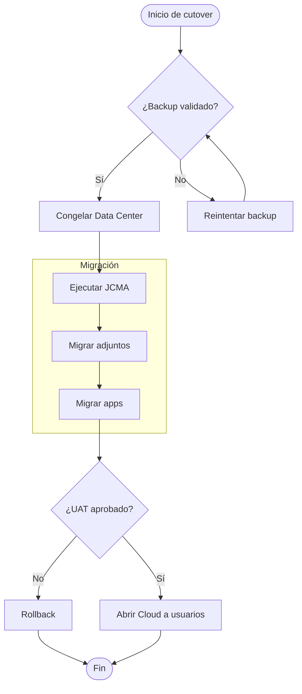

### 2.2 Diagrama de secuencia

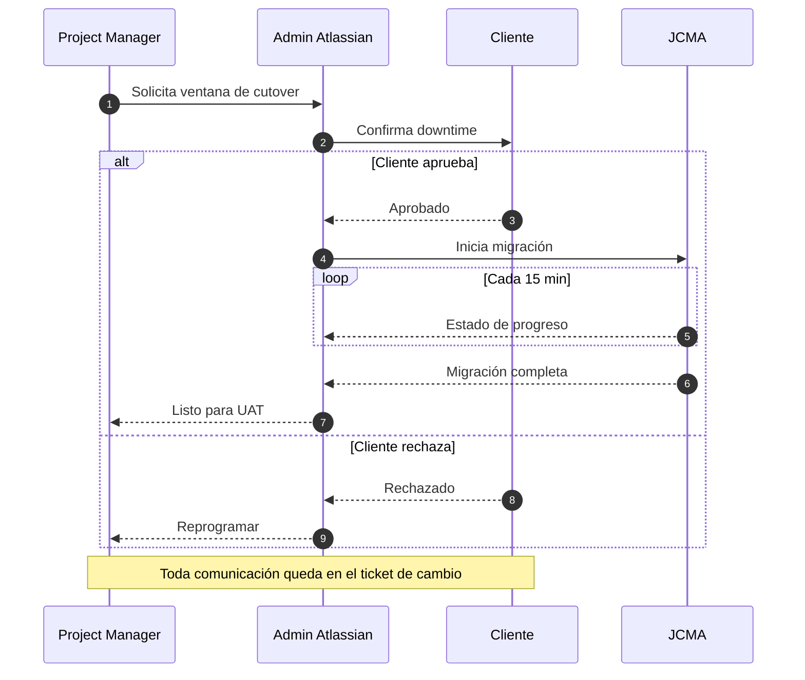

### 2.3 Diagrama de estados (workflow de incidentes)

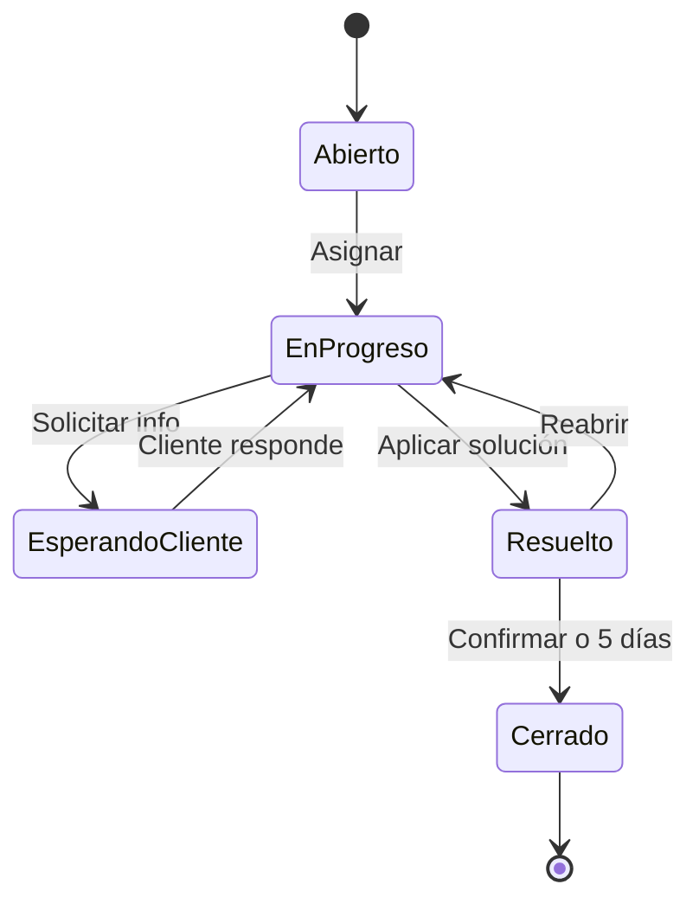

### 2.4 Diagrama entidad-relación

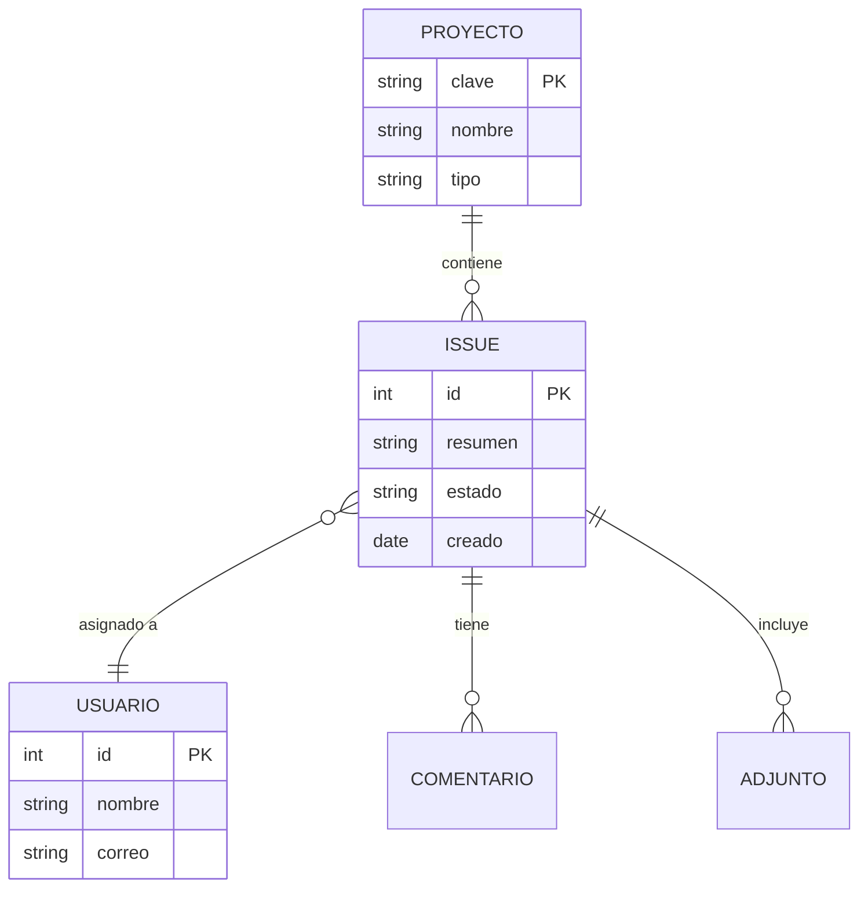

### 2.5 Diagrama de clases

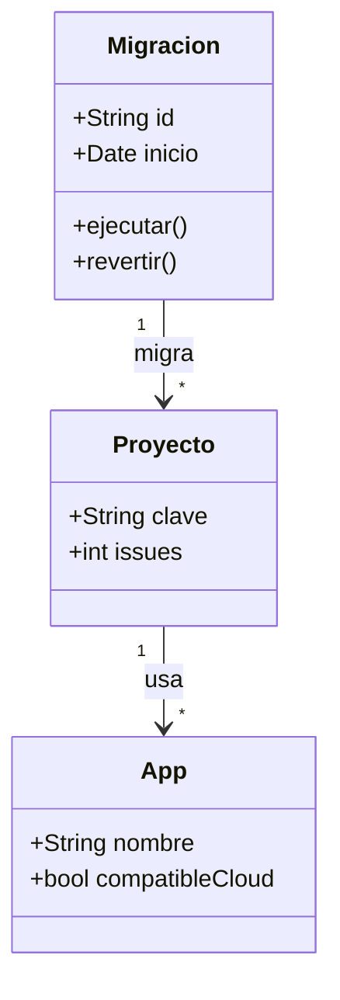

### 2.6 Cronograma Gantt

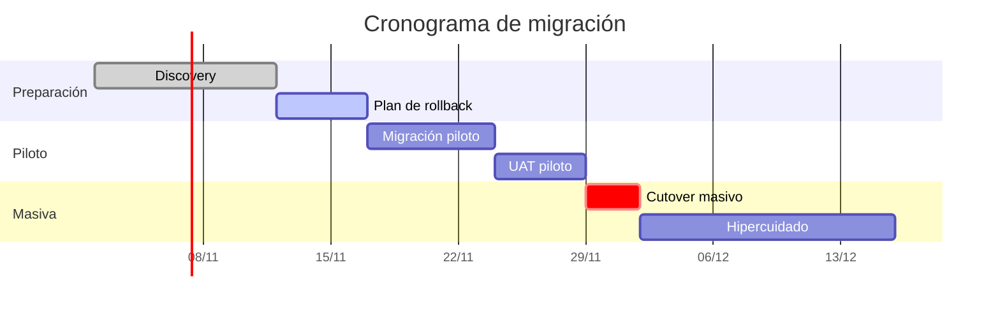

### 2.7 Gráfico de pastel

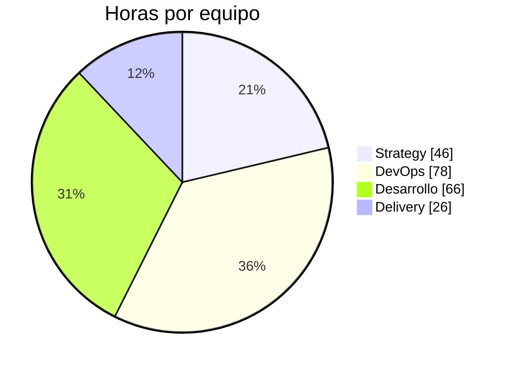

### 2.8 Mapa mental

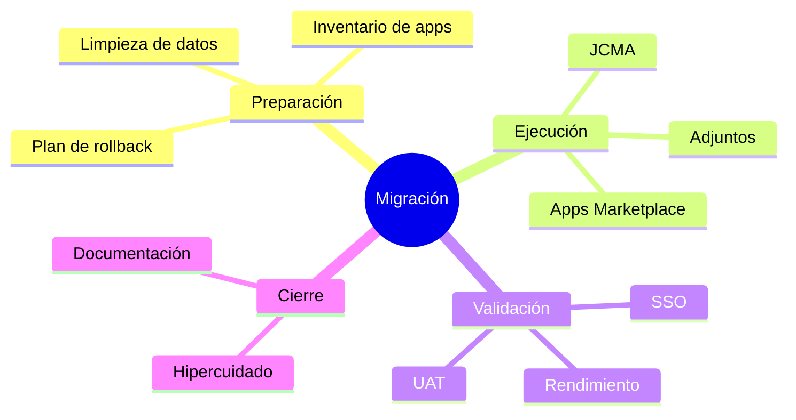

### 2.9 Línea de tiempo

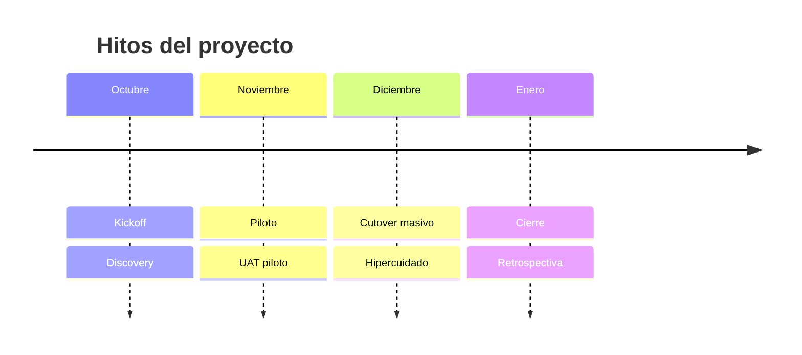

### 2.10 Recorrido de usuario

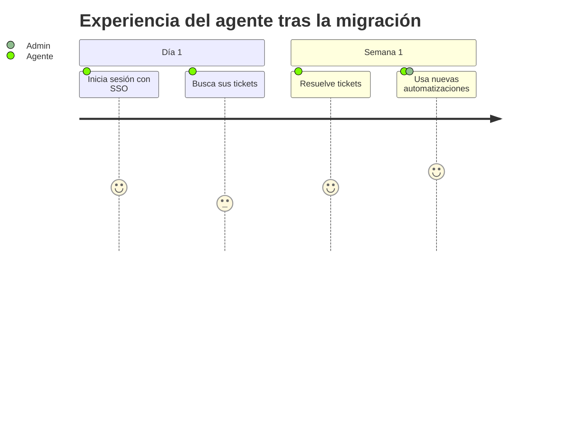

### 2.11 Flujo de ramas Git

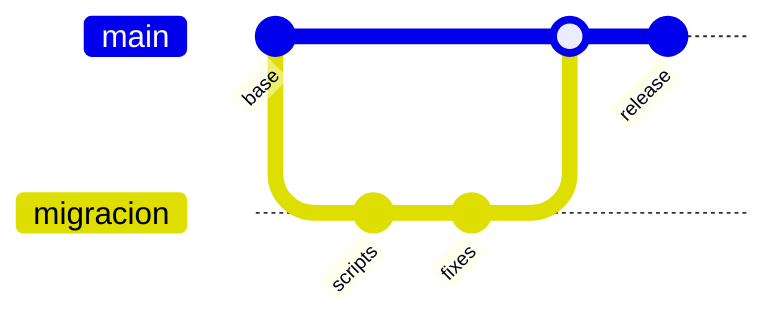

### 2.12 Diagrama muy grande (para probar el zoom)

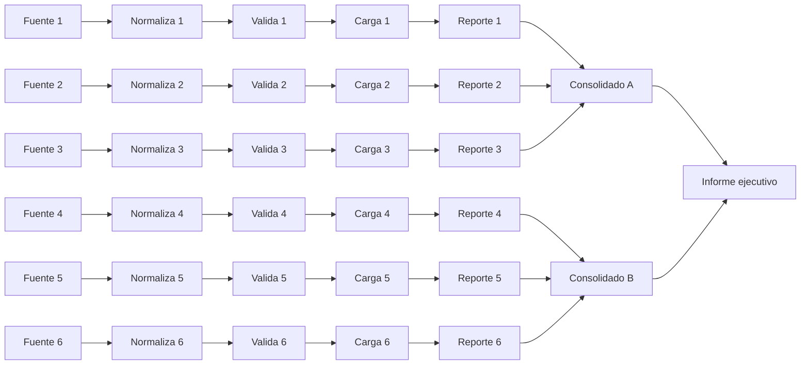

### 2.13 Diagrama con error (intencional)

El siguiente bloque tiene sintaxis inválida para probar cómo se muestra el error:

```mermaid
flowchart TD
    A --> --> B[[
    C ---> ???
```

---

## 3. Otros elementos difíciles de leer

### 3.1 Listas anidadas y tareas

- Preparación
  - Inventario
    - Apps de Marketplace
      - Compatibles con Cloud
      - Sin versión Cloud (requieren alternativa)
    - Campos personalizados
  - Limpieza
- Ejecución
  1. Congelar DC
  2. Ejecutar JCMA
     1. Proyectos piloto
     2. Resto de proyectos
  3. Validar

Lista de tareas:

- [x] Inventario de apps completo
- [x] Sandbox configurado
- [ ] Validar SSO en Cloud
- [ ] Plan de rollback aprobado
  - [ ] Revisión del cliente
  - [ ] Firma del sponsor

### 3.2 Citas anidadas

> Primer nivel de cita, con **énfasis**.
>
> > Segundo nivel: una decisión tomada en reunión.
> >
> > > Tercer nivel: el motivo detrás de la decisión.

### 3.3 Diagrama ASCII en bloque de código

```text
+-------------+      +--------------+      +-------------+
|  Data       | ---> |   JCMA /     | ---> |   Jira      |
|  Center     |      |   CCMA       |      |   Cloud     |
+-------------+      +--------------+      +-------------+
      |                     |                     ^
      v                     v                     |
+-------------+      +--------------+             |
|  Backups    |      |  Marketplace | ------------+
|  (snapshot) |      |  Apps        |
+-------------+      +--------------+
```

### 3.4 Código en varios lenguajes

```python
def prioridad_real(impacto: int, urgencia: int) -> int:
    """Calcula la prioridad como impacto x urgencia, redondeando hacia arriba."""
    return min(5, max(1, -(-impacto * urgencia // 3)))
```

```json
{
  "proyecto": "P-001",
  "migracion": {
    "ventana": { "inicio": "2026-11-14T02:00:00-06:00", "duracion_horas": 6 },
    "apps": ["ScriptRunner", "Insight"],
    "rollback": true
  }
}
```

```yaml
automation:
  name: cierre-automatico
  trigger: issue_transitioned
  condition:
    status: Resuelto
    sin_respuesta_dias: 5
  action:
    transition: Cerrado
```

```bash
# Línea muy larga para probar el scroll horizontal del bloque de código
curl -s -X POST "https://tu-instancia.example.invalid/rest/api/3/issue" -H "Content-Type: application/json" -H "Authorization: Bearer $TOKEN" -d '{"fields":{"project":{"key":"P001"},"summary":"Ticket de prueba generado desde script","issuetype":{"name":"Task"}}}'
```

```sql
SELECT p.pkey AS proyecto, COUNT(i.id) AS issues
FROM project p
JOIN jiraissue i ON i.project = p.id
GROUP BY p.pkey
HAVING COUNT(i.id) > 1000
ORDER BY issues DESC;
```

### 3.5 Bloque desplegable (HTML)

<details>
<summary>Ver el detalle del inventario de apps</summary>

Contenido oculto por defecto, con **Markdown dentro** de HTML y una lista:

- ScriptRunner — requiere reescritura
- Insight — migra a Assets
- Xray — versión Cloud disponible

</details>

### 3.6 Teclas, énfasis y caracteres especiales

Presiona <kbd>Ctrl</kbd> + <kbd>K</kbd> para buscar. Texto con ~~tachado~~, **negrita**, *cursiva*, ***ambas***, `código`, y símbolos: → ← ↔ ≥ ≤ ≠ — “comillas” — ñ á é í ó ú ü ¿? ¡!

Línea con
salto forzado mediante dos espacios al final.

### 3.7 Elementos que el lector NO soporta (para ver su comportamiento)

Imagen externa (se bloquea a propósito): 

Enlace relativo (no se puede abrir): [otro documento](./otro.md)

Nota al pie en sintaxis extendida[^1] (marked no la procesa).

[^1]: Esta nota al pie probablemente aparezca como texto plano.

---

## Riesgos y mitigaciones

| # | Riesgo | Probabilidad | Impacto | Mitigación |
|--:|---|:-:|:-:|---|
| 1 | Apps sin versión Cloud | Alta | Alto | Evaluar alternativas en Marketplace antes del piloto |
| 2 | Límites de tasa de JCMA | Media | Medio | Dividir la migración en lotes por proyecto |
| 3 | Adjuntos corruptos | Baja | Alto | Validar checksums en sandbox |
| 4 | SSO mal configurado | Media | Alto | Probar con grupo piloto antes del cutover |

## Riesgos y mitigaciones

Este encabezado repite el nombre del anterior, a propósito, para probar que los enlaces `#` y el índice lateral distinguen ambos.
